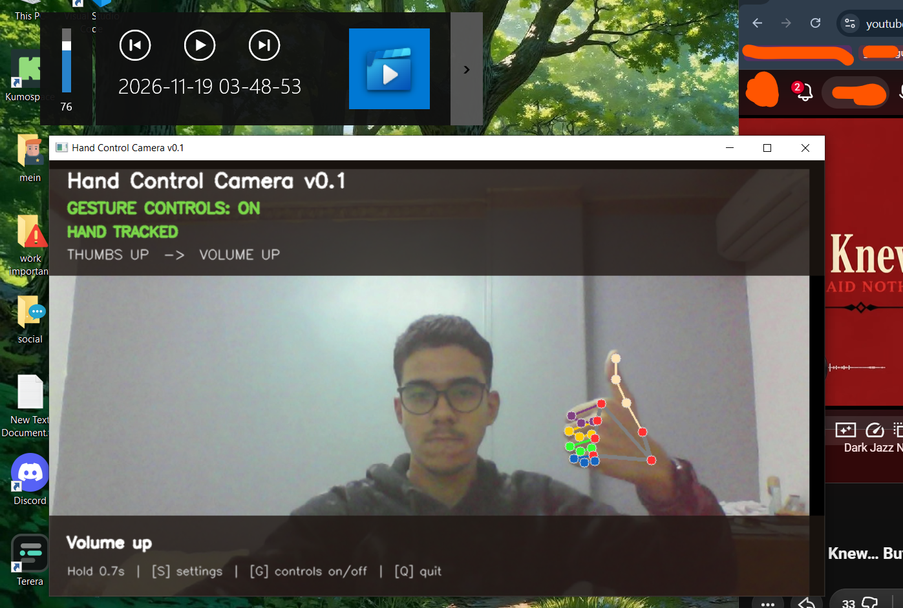
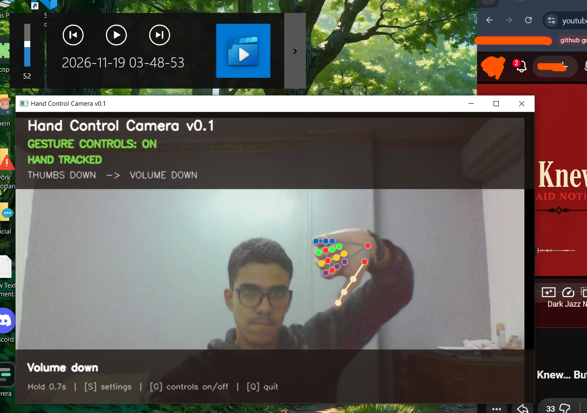
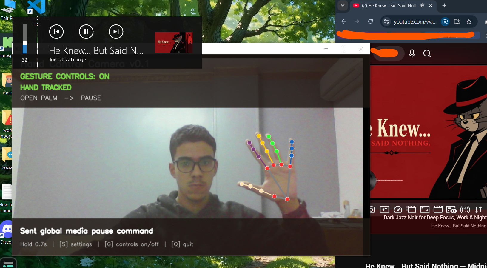
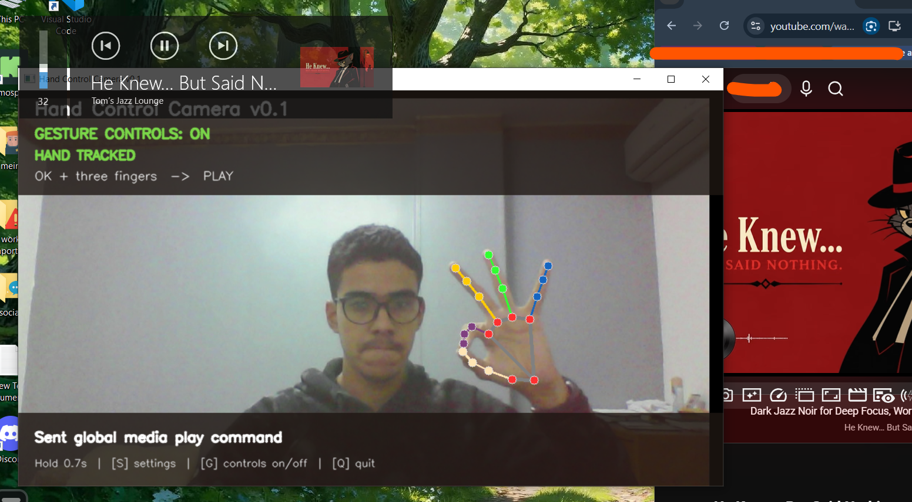

# Hand Control Camera v0.1

A Windows desktop app for touch-free media control. **Hand Control Camera** uses a webcam to recognise deliberate hand signs so you can pause media, resume playback, or change the Windows master volume without touching a keyboard or mouse.

It is designed for practical situations such as eating, cooking, exercising, or working with messy hands.

> **Status:** Early prototype / version 0.1. Please read the [known limitations](#known-limitations-and-workarounds) before using it.

## Open source and contributions

Hand Control Camera is available under the [Apache License 2.0](LICENSE). You may use, study, modify, and redistribute the source code and derivative works under that license, including its notice and attribution requirements.

Contributions are welcome—especially gesture-recognition reliability fixes, accessibility improvements, tests, privacy safeguards, and documentation improvements. Read [CONTRIBUTING.md](CONTRIBUTING.md) before opening a pull request.

Only installers published on this repository’s official **GitHub Releases** page are tested and supported by the project maintainers. Community builds and modified forks may be useful, but users should treat them as unofficial and verify their source before running them.

---

## Screenshots

The following screenshots show the live camera window detecting each supported gesture and sending the corresponding control.

### 👍 Volume up



### 👎 Volume down



### ✋ Pause media



### 👌 Play media



> These are real demonstration screenshots. They show the webcam preview, hand-landmark overlay, gesture status, and the Windows media-control feedback.

---

## Features

- Local webcam hand tracking with MediaPipe
- Four simple gesture controls
- Windows master-volume adjustment
- Global media play/pause command for supported media apps
- On-screen hand-tracking and gesture feedback
- Configurable camera, sensitivity, hold delay, mirror preview, and volume step
- Local-only camera processing: no camera recording or cloud upload by default
- Windows installer with a required Terms and Conditions acceptance page

---

## Supported gestures

| Gesture | Action | How it works |
|---|---|---|
| ✋ Open palm / high five | Pause media | Hold the palm steady for about 0.7 seconds. |
| 👌 OK sign with three raised fingers | Play media | Touch thumb and index finger together; keep the other three fingers straight. |
| 👍 Thumb up | Increase volume | Changes Windows master volume in small steps. |
| 👎 Thumb down | Decrease volume | Changes Windows master volume in small steps. |

For best results, keep one hand fully visible, face your palm towards the webcam, and use even front-facing lighting.

---

## Install on Windows

1. Download the latest `Hand-Control-Camera-v0.1-Setup.exe` file from this repository’s **Releases** page.
2. Double-click the installer.
3. Read the Terms and Conditions, select **I accept the agreement**, then continue.
4. Launch **Hand Control Camera** from the Start Menu or its desktop shortcut.
5. When Windows asks, allow camera access.

### Camera permission

If the camera does not open:

1. Open **Windows Settings**.
2. Go to **Privacy & security → Camera**.
3. Turn on **Camera access** and **Let desktop apps access your camera**.
4. Close Zoom, Teams, Discord, browser camera tabs, or other apps currently using the camera.

---

## Using the app

### Keyboard shortcuts

| Key | Action |
|---|---|
| `S` | Open Settings |
| `G` | Turn gesture controls on or off |
| `Q` or `Esc` | Close the app safely |

### Settings

Press `S` in the camera window to configure:

- **Camera number** — use this if your computer has more than one camera; restart after changing it.
- **Mirror preview** — turn the webcam mirror effect on or off.
- **Hand sensitivity** — Low, Normal, or High; restart after changing it.
- **Gesture hold delay** — from 0.3 to 1.5 seconds.
- **Volume step** — from 1% to 10% per gesture step.
- **Gesture controls** — enable or disable all gesture actions.

Inside the Settings panel:

- `W` or `Enter` — save settings
- `R` — restore default settings
- `Esc` — cancel settings changes

Settings are saved locally. They do not include camera images, video, audio, media titles, or account data.

---

## Known limitations and workarounds

This is important for version 0.1.

### 1. Gesture controls may sometimes look unresponsive

Sometimes switching Gesture Controls on/off with `G` may not appear to work immediately.

**Try this:**

1. Click once inside the Hand Control Camera window so it has keyboard focus.
2. Press `G` once, then look for the **GESTURE CONTROLS: ON/OFF** message at the top of the camera window.
3. Move your hand away from a recognised pose for one second, then try again.
4. If it still does not respond, close the app with `Q` and start it again.

### 2. The window close button may not always close the app cleanly

The current app uses an OpenCV camera window. On some Windows computers, clicking the window’s **X** button can sometimes leave the camera process running or make the window appear frozen.

**Use `Q` or `Esc` inside the camera window to close the app safely.**

If the app does not close:

1. Press `Ctrl + Shift + Esc` to open **Task Manager**.
2. Find **Hand Control Camera** or `HandControlCamera.exe`.
3. Select it and choose **End task**.

### 3. Play/pause may not control every video or music app

The app sends the standard Windows global media play/pause command. It works only when the target app exposes an active Windows media session.

- It usually works with many browser videos, Spotify, VLC, and other common media apps.
- It may not work with every browser tab, website, or media player.
- The command is a system-level toggle, so use ✋ while media is playing and 👌 while it is paused.

### 4. Camera or gesture detection may fail in poor conditions

Recognition can be less reliable in dark rooms, strong backlighting, when the hand is partly outside the frame, or if the hand is too close to the camera.

**Try this:** use better front lighting, show the whole hand, and hold the sign still for slightly longer.

### 5. Camera and sensitivity changes require a restart

The Settings panel saves these choices, but version 0.1 applies a new camera number or sensitivity level only when the app is opened again.

---

## Privacy and permitted controls

The app is permitted to use only:

- The selected webcam for local live hand-gesture recognition and preview
- Windows global media play/pause commands
- Windows master output-volume control
- Local app settings needed for operation

The app is not intended to record or upload camera data, use the microphone, access files, read accounts or passwords, make purchases, or install unrelated software.

The installer shows the complete Terms and Conditions before installation.

---

## Security and download verification

Download the installer only from this repository’s official **GitHub Releases** page. Do not install copies sent through unknown links, messages, email attachments, unofficial websites, or file-sharing services.

The v0.1 installer is **not yet Authenticode code-signed**, so Windows may show a SmartScreen or unknown-publisher warning. Until the project has a trusted publisher signature, verify the downloaded file against the official SHA-256 checksum:

```text
d4874e23555ce6cef7e0ae38a2687df1b34e5cefc92f6fac4a4e36699442781c  Hand-Control-Camera-v0.1-Setup.exe
```

In PowerShell:

```powershell
Get-FileHash .\Hand-Control-Camera-v0.1-Setup.exe -Algorithm SHA256
```

The resulting value must match exactly. If it does not, delete the file and download it again from the official Release. Read the full [Security Policy](SECURITY.md) for verification guidance, current signing status, and how to report a vulnerability.

> **Maintainer note:** Future installers and application EXEs should be Authenticode-signed and timestamped. Follow the [release and code-signing checklist](docs/RELEASE_CHECKLIST.md) before every public release.

---

## Compatibility

- **Operating system:** 64-bit Windows 10 or Windows 11
- **Camera:** Built-in or USB webcam
- **Internet:** Not required while using the installed app

---

## Project status

Hand Control Camera v0.1 is a proof-of-concept release. Planned improvements include:

- More reliable direct play and pause control
- Built-in video-player mode
- Better hand orientation handling
- More gesture customisation
- First-run gesture calibration
- A more polished native settings interface

---

## Feedback

If a gesture fails, include the following information in an issue report:

- Windows version
- Camera model, if known
- Media app or website you were controlling
- Lighting conditions
- Which gesture did not work
- Whether the on-screen app status detected the gesture

This makes it much easier to improve the next version.
